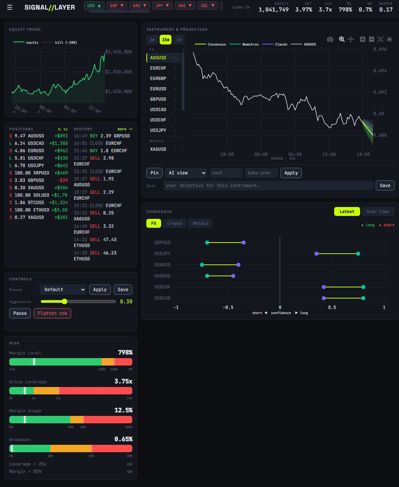
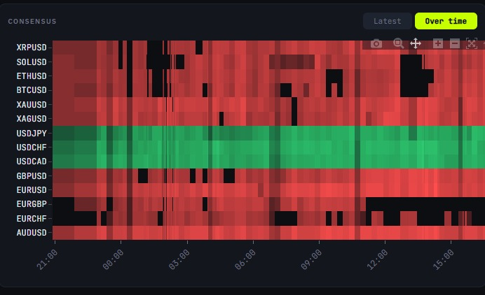

# SIGNAL//LAYER — the operator control panel

A web dashboard for monitoring and (optionally) steering the live trading engine. It is a **separate process** that reads the engine's decision logs, equity samples, and live MetaTrader 5 state. By default it is strictly **read-only** and the engine is unaware it exists — the engine behaves byte-for-byte as it would without the panel.

> **Safety in one line:** every engine behaviour the panel can trigger is gated behind `EngineConfig.use_control_panel` (default `False`). With that flag off, the panel cannot affect trading at all. The kill-switch and risk floor always run first and can never be overridden by an operator control.



*The Dashboard view. Header KPIs across the top; operator column on the left; signal column (instrument projection + Claude×Nemotron consensus dumbbell) on the right. Numbers shown are dry-run/sample data.*

---

## Running it

The normal way is the **interactive launcher** at the repo root — double-click `run_live.bat` (or run it from a terminal). It asks two questions, in order:

1. **Mode** — `[L]ive trading` or `[D]ry-run` (dry-run sends no orders).
2. **Panel** — `[W]ith panel` or `[N]o panel`.

Choosing **With panel** does two things: it launches this dashboard in its own window (uvicorn on port 8800) **and** sets `QUANTHACK_PANEL=1` for the engine, which flips `use_control_panel` on so the operator controls actually steer the bot. Choosing **No panel** runs the engine exactly as it would with no panel code at all. The engine itself runs in the launcher window; press Ctrl+C there to stop it.

```text
===============================================
           QUANTHACK  LAUNCHER
===============================================

Mode  -  [L]ive trading   [D]ry-run : D
Panel -  [W]ith panel   [N]o panel : W

  Mode : DRY-RUN (no orders sent)
  Panel: ON  -  dashboard at http://127.0.0.1:8800
```

**Watch-only (no engine):** to bring up the dashboard against existing logs without touching the engine, run it standalone — it stays strictly read-only because `QUANTHACK_PANEL` is never set:

```powershell
# from the repo root (the launcher cd's there itself)
.\panel\run_panel.ps1
```

Then open **http://127.0.0.1:8800**. First load: do a hard refresh (Ctrl+Shift+R) — browsers cache the JS aggressively.

- It reads `logs/ai_decisions_*.jsonl`, `state/equity_samples.json`, and live MT5. Charts that need MT5 (live positions, the projection price line) degrade gracefully to an "unavailable" note when no terminal is connected; everything else renders from the logs alone.
- New deps: `fastapi`, `uvicorn` (already in `requirements.txt`). Charts use Plotly.js from a CDN.

---

## The layout

The dashboard (**SIGNAL//LAYER**) is a single-page app with three views, switched from the **hamburger menu** (top-left): **Dashboard** (the default), **History**, and **Scalper**. A persistent **header strip** sits above all of them:

- **Brand + nav** — `SIGNAL//LAYER` and the hamburger menu.
- **Regime pills** — `CLAUDE` and `NEMOTRON` each show the model's one-word market regime; **click either pill** to open a modal with that model's full natural-language reasoning from the latest read (side-by-side Claude vs Nemotron).
- **Views-age badge** — how long ago the AI last refreshed (a staleness guard; goes amber/red as the 15-min read ages).
- **Currency-strength ribbon** — each currency/asset (USD, GBP, XAU, JPY, XAG, SOL…) aggregated **net up/down across all its pairs**, shown with a direction arrow.
- **KPI strip** — live `EQUITY`, `RET` (return %), `LEV` (gross leverage), `ML` (margin level), `DD` (drawdown), `SHARPE`.

### Dashboard view

**Left column (operator):**
- **Equity Trend** — the equity curve with the **kill line drawn on it** (the −20% drawdown floor), framed tightly so real movement is visible.
- **Positions / History split** — open positions (refreshing every **1 s**, signed lots + live P&L) beside a rolling order/decision feed (`more →` expands it).
- **Controls** — the steering knobs (Phase 2/3 below): preset selector + Apply/Save, the `aggression` slider, **Pause**, **Flatten now**.
- **Risk** — horizontal gauges (margin level, gross leverage, margin usage, drawdown) with **threshold ticks** (0 / competition tripwire / max) drawn on each bar, the bars re-colouring live as values move, plus the 30-minute tripwire clocks.

**Main column (signal):**
- **Instrument & projection** — a symbol list grouped by asset class (FX / Metals / Crypto) with a **1m / 15m / 1h** timeframe toggle; the selected symbol's recent price (scroll/zoom, crosshair hover) with a forward **projection cone per model** (slope = confidence, width = volatility). This is an honest rendering of conviction + uncertainty — **not** a price forecast (the models output direction + confidence, not target levels). Below the chart is the per-position override row (Phase 3 below) and a per-ticker **Goal** note.
- **Consensus** — tabbed **Latest** / **Over time**:
  - **Latest** is the **dumbbell** — per instrument, Claude (violet) and Nemotron (teal) confidence + direction on a short↔long axis, with a connecting line that encodes agreement (chartreuse = agree/boosted, red = disagree). Sub-tabs split it by **FX / Crypto / Metals**.
  - **Over time** is the **heatmap** — instruments × 15-min timesteps, coloured red→green by signed confidence (long = green, short = red), with a long/short legend.

    

### History view
Per-symbol stance-over-time chart plus that symbol's order history — the audit trail for "what did the AI think about EURUSD all day, and what did we trade."

### Scalper view
Status page for the **dormant** mean-reversion scalper (a separate process, own magic `990624`): its backtest verdict (no durable edge → stays disabled) and config. It only ever shows a live view if the scalper is armed and emitting state; by default it ships off. See [STRATEGY.md](STRATEGY.md).

## The three control phases

The panel is built in three layers. Phase 1 is read-only; Phases 2–3 add the (default-off) control channel.

### Phase 1 — Watch (read-only, zero engine risk)
Everything described under **Dashboard / History / Scalper** above reads only `logs/`, `state/`, and live MT5 (account / positions / bars). Charts that need MT5 degrade to an "unavailable" note when no terminal is connected; the rest renders from the logs alone.

### Phase 2 — Steer (global knobs + presets)
- **Knobs:** an `aggression` slider, global **Pause** (no new risk), **Flatten now** (panic close-all), and per-symbol **allow/block** (a de-risk clamp — it never force-closes).
- **Presets:** named bundles of the knobs — ships with `Default` (the tuned 0.30 aggression), `Survival` (0.0), `Finals` (1.0); create / save / switch / reset.

### Phase 3 — Weigh in (per-position)
- **Pin/lock** — the engine won't rebalance, close, or trail that position until you unpin.
- **Override as your view** — set a direction + confidence for a symbol; it becomes the deciding "third opinion" alongside Claude and Nemotron and *can flip the AI's direction*.
- **Take-profit** — an optional per-position broker-side TP (the default strategy has no TP and trails the winner instead; this is a manual override on chosen positions).
- **Per-ticker note** — a persistent objective you write per instrument, shown alongside the AI's live rationale.

---

## Enabling the control channel

The launcher does this for you: choosing **With panel** in `run_live.bat` sets `QUANTHACK_PANEL=1`, and `EngineConfig.use_control_panel` defaults to `os.environ.get("QUANTHACK_PANEL") == "1"` (see [`bot/config.py`](../bot/config.py)). So:

- **`run_live.bat` → With panel** → controls live (engine reads knobs/presets/overrides).
- **`run_live.bat` → No panel**, or the standalone `panel\run_panel.ps1` (which never sets the env var) → the engine ignores the control files; the UI is a pure monitor. Your bot is byte-for-byte unchanged.

To pin it on without the launcher, either export `QUANTHACK_PANEL=1` before starting the engine, or hard-set `use_control_panel = True` in `bot/config.py`. Either way, restart the engine for the change to take effect.

---

## How control flows to the engine (the contract)

The panel and engine communicate through small JSON files in `state/`, with a strict single-writer protocol:

| File | Written by | Read by | Contents |
|---|---|---|---|
| `state/controls.json` | panel (sole writer) | engine | paused, aggression, block/allow, active preset, one-shot `flatten_seq`/`apply_seq` |
| `state/presets.json` | panel (sole writer) | panel | named knob bundles |
| `state/overrides.json` | panel (sole writer) | engine | per-symbol `{pinned, view, take_profit, note}` |
| `state/control_ack.json` | **engine** (sole writer) | panel | processed one-shot sequence numbers |

Cadence:
- **`flatten_seq`** (panic flatten) is honoured **intra-tick**, right after the kill-switch.
- **Pause / block / aggression / human view** apply on the *apply-forced reconcile*: the panel bumps `apply_seq` on every change, the engine forces a reconcile on the next tick, so a change takes effect within ~2 ticks (~10s). (Forcing it literally every tick would defeat the anti-churn gate and bleed spread.)

---

## Safety model

The control layer was designed and reviewed so it can never compromise the engine:

- **Default-off.** All engine integration is behind `use_control_panel` (default `False`) → flag-off behaviour is byte-for-byte identical to a build without the panel (verified branch-by-branch + by regression tests).
- **The risk floor is never gated.** `risk.assess` / the kill-switch / `flatten_all` / the soft de-risk path run **before** any control or override is even loaded. A pinned or human-overridden position **is still flattened by the kill-switch**.
- **Read-only Phase 1.** The dashboard only reads logs/state/MT5; it has no order/modify path. Live MT5 calls are read-only (account / positions / bars) and degrade cleanly when absent.
- **Dry-run sends nothing.** Operator flatten and take-profit print intended actions in dry-run and never hit the broker.
- **Single-writer + one-shot ack.** The engine never writes the control files; one-shot commands use monotonic sequence numbers acknowledged in an engine-owned file, so there are no two-writer races.
- **Block = de-risk clamp, not close.** Blocking a symbol forbids new/increased risk; it never actively closes a position.
- **A malformed control/override file can never crash the trading loop** — the accessors skip bad entries defensively.

---

## Architecture

```
 engine ──writes──▶ logs/ai_decisions_*.jsonl, state/equity_samples.json ──read──▶ panel backend (FastAPI)
   ▲                                                                                  │  reads logs + live MT5
   └── reads ── state/controls.json + state/overrides.json ◀── writes ── panel backend │  serves the SPA
                                  (engine writes only state/control_ack.json)          ▼
                                                                              panel frontend (Plotly SPA)
```

- **Backend:** `panel/backend/` — `data.py` (pure log/equity transforms), `projection.py` (cone geometry), `app.py` (FastAPI routes + the control/override read-write API).
- **Frontend:** `panel/frontend/` — `index.html` / `styles.css` / `app.js`, the SIGNAL//LAYER theme and Plotly charts.
